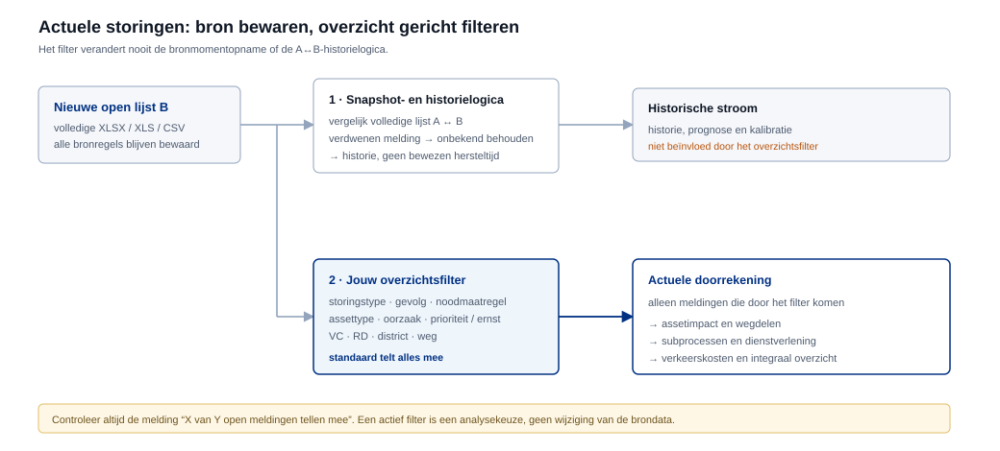
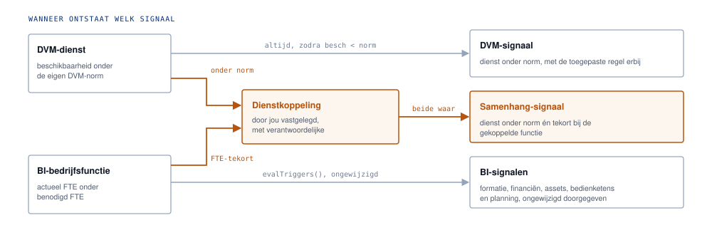

# Processflow van BiDash

BiDash brengt drie informatiedomeinen samen rond één doel: de VWM-dienstverlening. Bedrijfsvoering beschrijft of de organisatie de dienst kan uitvoeren, technische middelen beschrijven of de benodigde assets beschikbaar zijn en planning/context beschrijft externe en tijdgebonden invloeden. Rule engine en trigger engine vertalen die bronnen naar dienstimpact, signalen en besluitinformatie. Alles rekent in de browser van de gebruiker. Er gaat geen bronbestand het apparaat af.


De inhoudelijke denkwijze staat ook in de [logische architectuur](architectuur.md).

## 1. De app en documentatie komen van GitHub, de gegevens nooit

De workflow publiceert de map `site/` naar GitHub Pages. Vóór het publicatie-artifact wordt gemaakt voert de teststap `scripts/stage-docs.mjs` uit. Die kopieert de repositorydocumentatie naar `site/docs/` en maakt `site/help-docs.js` uit de echte Markdown-bestanden. Deze twee paden zijn gegenereerd en worden niet in Git opgeslagen.

De gebruiker haalt statische applicatiebestanden, uitleg en afbeeldingen op. Vanaf 2.47 bevat het artifact ook een periodiek opgehaalde openbare NDW-feed. Eigen operationele bronbestanden worden nooit onderdeel van die publicatie. De hoofdapp behoudt een Content Security Policy met `connect-src 'none'`; de Help-viewer heeft geen fetch of externe Markdown-service nodig, omdat de Markdown tijdens publicatie lokaal in de Help-bundel is opgenomen.

## 2. Je kiest bestanden en ziet eerst wat er verandert

NDW-verkeersdata heeft in Bronbeheer twee uploads: meetlocaties en trafficspeed. De configuratie wordt één keer per bronwijziging verwerkt en blijft tijdens de sessie beschikbaar. Trafficspeed wordt via meetlocatie-ID en meetindex aan die configuratie gekoppeld. Beide laadvolgordes zijn ondersteund. Een nieuwe verkeersupload gebruikt dezelfde verwerkte tabel; een parsefout wist de configuratie of vorige geldige verkeerssnapshot niet. Beide bronnen melden hun voortgang via de bestaande DVM-importvoortgang. Alleen de geslaagde gecombineerde verkeerssnapshot wordt onderdeel van de opgeslagen kostenparameters; de losse bestanden en configuratiecache worden niet geëxporteerd. De bestaande gecombineerde DATEX II v3- en exportupload blijven beschikbaar.

De gecombineerde verkeerssnapshot wordt daarna via één gedeelde weg- en richtingsnormalisatie gekoppeld aan de representatieve storing per wegdeel. De NDW-index bewaart daarbij de A/N-aanduiding. MONIBAS levert locatiekenmerken waar beschikbaar; de kandidaat moet dezelfde weg en rijrichting hebben. De dichtstbijzijnde geldige intensiteit wordt gekozen zonder vaste afstandsgrens. Boven één kilometer wordt de koppeling als ruimer gemarkeerd, met afstand en een controle op lokale op- en afritten. Een verdwenen of ongeldig opgeslagen meetpunt krijgt een nieuw geldig voorstel. Alle actuele wegdelen blijven zichtbaar; ontbrekende intensiteiten houden een reden en onbekende kosten. De bronkaart volgt de huidige wegdeelselectie. Bevestigde en nog te controleren locaties worden apart geteld. Bevestigen ververst die telling direct in bronkaart, NDW-overzicht en Verkeerskosten en meldt de wijziging aan de bestaande opslagqueue. Het berekenbare aantal en de kosten veranderen alleen door gewijzigde verkeersinvoer, niet door dezelfde locatie te bevestigen. Een ander meetpunt of bron maakt opnieuw controle nodig. De bestaande NDW-beperking bij uitgesteld herstel blijft van toepassing. Pas een geldige koppeling vult de NDW-intensiteit in het bestaande kostenscenario in; meetpunten achter elkaar worden niet opgeteld.

Onder Laden en exporteren kies je een DVM-totaal-JSON, een integrale BiDash-bundel, een BI Dash-JSON of een planning-XML uit Primavera P6 of MS Project. Voordat er iets verandert draait `validate()` over de inhoud. Objectsleutels als `__proto__` worden geweigerd en te diep geneste bestanden afgebroken. Daarna krijg je een lijst van precies die onderdelen die vervangen gaan worden. Alles wat het bestand niet meelevert blijft staan. Mislukt de import halverwege, dan blijft de vorige opgeslagen werkruimte behouden en moet de pagina worden herladen om de opgeslagen toestand terug te zetten.

Tijdens deze stap toont de hoofdapp een voortgangsbalk onder de statusregel. Voor bestanden die via **Data & export** worden gekozen, wordt de leesfase gemeten met `FileReader` en echte bytevoortgang. Zodra het lezen klaar is krijgt de browser eerst gelegenheid de status te tekenen voordat JSON- of XML-parsing begint. Zware parsing kan de hoofdthread nog kort blokkeren; de voortgang kan dan tijdelijk stilstaan zonder dat dit betekent dat het proces is afgebroken.

Specialistische technische bronnen, zoals All Assets, historische storingen, open storingen, U-routes en werkzaamheden, laad je via DVM-bronbeheer. EOL en installatie-/ingebruiknamedatum zijn velden van All Assets en geen aparte bron. De bestaande DVM-importfasen en percentages worden via `hub:import-progress` ook naar dezelfde voortgangsbalk in de hoofdapp gestuurd. Daardoor ziet de gebruiker één doorlopende importstatus voor zowel de hub-import als de specialistische DVM-bronnen.

De knop **Laad laatste stand** gebruikt dezelfde veilige importstroom. De gebruiker
koppelt één keer de lokale map die OneDrive met SharePoint synchroniseert. BiDash
onthoudt alleen de maptoegang, zoekt bij iedere klik de nieuwste geldige integrale
of DVM-totaal-JSON en toont die eerst als importvoorstel. De keuze volgt de
exporttijd in `opgeslagen`, anders de datum in de bestandsnaam en ten slotte de
wijzigingsdatum. Andere JSON-bestanden worden genegeerd. In een browser zonder
blijvende mapkoppeling kiest de gebruiker de map per keer opnieuw.

OneDrive verzorgt de synchronisatie buiten BiDash. De applicatie doet zelf geen
SharePoint- of Graph-verzoek en de Content Security Policy blijft
`connect-src 'none'`.

Een export uit **Data & export** volgt twee lokale paden: de gewone browserdownload
blijft bestaan en BiDash schrijft hetzelfde bestand daarnaast naar de gekoppelde
map als de gebruiker schrijfrechten geeft. Integrale, DVM-, BI- en planningexports
krijgen een datum in de bestandsnaam. Bij een schrijffout blijft de download
behouden; de statusregel benoemt dat de mapkopie niet is gelukt. Een browser die
alleen de mapupload-terugval ondersteunt kan niet naar die gekozen map schrijven.

## 3. Actuele storingslijst is een vervangende momentopname

De invoer Open storingen accepteert XLSX, XLS en CSV met herkenbare storingsregels. Deze lijst is geen extra historische bron. De nieuwe lijst vervangt de vorige actuele momentopname volledig, ook als de bestandsnaam anders is.

BiDash vergelijkt de volledige oude en nieuwe lijst op VC, type, locatie, eenheid, foutcode en bronstart. Een bron-ID alleen is onvoldoende. Nieuwe waarnemingen bewaren eerste/laatste gezien en bronpeildatum; een ontbrekende melding blijft zichtbaar als onbekend en wordt eenmaal gehistoriseerd. Terugkeer werkt dezelfde historie bij. Een mislukt bestand breekt de volledige bestandenset af vóór toepassing.

MTM-mapimport bewaakt de dekking per VC. Eén afwezigheid is voorlopig; twee volledige opeenvolgende afwezigheden geven HERSTELD_AFGELEID met een venster. Een tijdgat boven standaard zes uur, onvolledige bron of verdachte volumedaling herstart die controle. CDMS OK/AAN is expliciet herstelbewijs voor dezelfde VC, DRIP en conditie, ook uit een volgende mapscan. Alleen zo'n bronmelding vult hersteld_op. Laatste waarneming en bronpeildatum zijn nooit een hersteltijd.

Na standaard 48 uur zonder nieuwe bevestiging wordt een open melding verouderd. De instelbare grenzen reizen mee met Parameters. De lijst en memo tonen technische meldingen en unieke assets apart; onvolledige identiteit en systeemmeldingen blijven zichtbaar. Onzekerheid blokkeert een bewezen exact actueel percentage. Bronrijbalans, toestand, dekking en herstelbewijs blijven bewaard in de volledige export; ontbrekende oude brongegevens worden niet verzonnen.

## 4. De gebruiker bepaalt wat van lijst B meetelt in het actuele overzicht

De bronmomentopname en de selectie voor de actuele doorrekening zijn bewust twee verschillende dingen. Nadat lijst B volledig is opgeslagen, kan de gebruiker in Datasetbeheer een filter instellen. Dat filter bepaalt alleen welke open bronregels doorstromen naar actuele assetimpact, wegdelen, subprocessen, dienstverlening en verkeerskosten.



Het filter kan waarden uitsluiten op storingstype of foutregel, gevolg, noodmaatregel, assettype, oorzaak, prioriteit of ernst, verkeerscentrale, regionale dienst, district en weg. Binnen één groep kunnen meerdere waarden meetellen; tussen groepen gelden de voorwaarden gezamenlijk. Een leeg bronveld is een expliciete waarde `(geen waarde)` en kan dus ook worden uitgesloten.

Iedere wijziging aan een vinkje wordt automatisch na een korte debounce op de actuele DVM-doorrekening toegepast. Er is geen aparte bevestigingsstap meer nodig. De knop onder de filterkaart is alleen nog bedoeld om naar het dienstoverzicht te navigeren.

De configuratie slaat alleen uitgesloten waarden op. Een nieuw type of gevolg dat in een volgende momentopname voor het eerst verschijnt, telt daardoor standaard mee. De filterconfiguratie staat in de DVM-configuratie (`RULES.cfg.liveOverviewFilter`) en reist mee wanneer de DVM-parameters worden geëxporteerd.

De tellingen volgen deze keten:

`open bronregels → geselecteerd door filter → DVM-validatie/locatie/foutregel/ontdubbeling → doorgerekende open meldingen → dienstimpact`

Daarom kan het aantal doorgerekende open meldingen lager zijn dan het aantal geselecteerde bronregels. Een bronregel kan na het gebruikersfilter nog afvallen doordat geen bruikbare locatie aanwezig is, geen passende foutregel bestaat of omdat dezelfde storing als echte doublure al is verwerkt. Dit is geen verwijdering uit de bronmomentopname.

De filterlaag mag de volgende stromen nooit veranderen:

- de volledige actuele bronlijst in `LIVE_STORINGSBRONNEN`;
- de vergelijking A ↔ B;
- het zichtbaar behouden en historiseren van verdwenen meldingen;
- historische storingsanalyse en prognosekalibratie;
- de inhoud van de bronbestanden zelf.

De filterkaart en het actuele dienstoverzicht tonen daarom afzonderlijk hoeveel bronregels er zijn, hoeveel door het filter zijn geselecteerd, hoeveel door het filter zijn uitgesloten en hoeveel meldingen uiteindelijk door DVM zijn doorgerekend. Zo is zichtbaar of een verschil door de gebruikersselectie of door de normale DVM-validatie ontstaat.

## 5. Drie domeinen leveren feiten, dienstverlening is het doel

De logische indeling is:

1. Bedrijfsvoering / BI: formatie, capaciteit, contracten, budget, leveranciers en interne bedienketens.
2. Technische middelen / DVM-assets: areaal, EOL, storingen, technische beschikbaarheid, prestatie, prognoses en assetgerelateerde verkeerskosten.
3. Planning en externe invloeden: activiteiten, afhankelijkheden, werkzaamheden, tijdvensters, U-routes en afsluitingen. De planningmodule begint leeg: de tijdlijn komt uit een geladen Primavera-export en de triggers uit een apart te laden JSON-bestand. Er staat geen planning meer in de code.

Deze drie domeinen staan logisch naast elkaar als bron van invloed. Geen van de drie is eigenaar van de andere. De bovenliggende laag is de dienstverlening zelf.

## 6. Rule engine vertaalt, trigger engine signaleert

De rule engine bepaalt wat meetelt en hoe bronfeiten doorwerken. Hier horen telregels, asset- en procesafhankelijkheden, gewichten, impactregels en expliciete dienst-functiekoppelingen thuis.

De trigger engine beoordeelt vervolgens wanneer een berekende toestand aandacht vraagt, bijvoorbeeld bij een dienst onder norm, capaciteitstekort, samenloop van technische uitval en personele krapte, een kostendrempel of een prognose die een grens passeert.

Rule engine en trigger engine zijn dus verschillend: de eerste bepaalt betekenis en doorwerking, de tweede bepaalt wanneer die uitkomst een signaal wordt.

### Expertduiding vóór regelwijziging

Onder **Regels & signalen / Expertinvoer** kan een inhoudelijk expert per dienstverlening de bestaande keten controleren. Het scherm toont de door DVM geleverde norm, uitkomst, subprocessen en assetafhankelijkheden en laadt de actuele subprocessen automatisch als modelvoorstel.

De invoer gebruikt vooral vaste keuzes over doel, proces, uitval, herstel, norm en bewijs. Ieder onderdeel en iedere vraag heeft een tooltip met het doel van de vraag en de verwerking van het antwoord. Extra uitleg is per vraag optioneel. Relaties, regels en signalen staan in een optioneel geavanceerd deel en zijn niet vereist voor beoordeling of vaststelling.

Een expert kan subprocessen toevoegen, verwijderen en wijzigen. Het dienstaandeel wordt als percentage ingevoerd. De aandelen van de subprocessen vormen samen 100%; bij wijziging van één aandeel verdeelt BiDash de rest naar verhouding over de overige subprocessen. Per gekozen DVM-assettype voert de expert ook een afhankelijkheidspercentage in. Deze assetpercentages zijn relatieve gewichten en hoeven samen geen 100% te zijn. DVM normaliseert de positieve waarden bij proefberekenen en toepassen. **Proefberekening uitvoeren** zet het voorstel tijdelijk in DVM, leest de nieuwe dienstuitkomst en herstelt meteen de actieve configuratie. Een volledig vastgesteld voorstel kan bewust worden toegepast. De vorige configuratie wordt als rollback-snapshot opgeslagen en kan met **Vorige model terugzetten** opnieuw actief worden gemaakt.

## 7. De engines rekenen binnen hun eigenaarschap

De oorspronkelijke applicaties draaien technisch nog elk in een eigen sandboxed `iframe`. Ze praten met de schil via `window.HUB`. De schil kent hun binnenwerk niet en herrekent domeinregels niet zelf.


DVM blijft eigenaar van storingsimpact, de actuele storingsselectie, assetafhankelijkheden, subprocessen, dienstnormen, verkeersscenario's en tarieven. BI blijft eigenaar van formatie, contracten, budget, bedienketens en planningscapaciteit. De oude BI-storingsimport is bewust stilgezet, zodat dezelfde storing niet twee keer meetelt.

De gecombineerde MTM-signaalgeverbron houdt MSI en detectielussen uit elkaar. MSI-alarmen voeden signalering. De bronwoorden lus, lussen, detectie, detector, detectielus, meetlus en inductielus krijgen intern assettype LUS, worden zichtbaar als Detectielus en voeden detectie. Bekende LUS-codes gebruiken de bestaande impactregels. Een onbekende detectorcode blijft als open bronregel zichtbaar, maar krijgt geen impact totdat een passende regel is vastgelegd.

Voor DRIP kan de complete historie ook de actuele bron voeden. BiDash selecteert alleen een expliciet open incident, een incident zonder eindtijd en afgeronde duur, of een gecensureerd incident dat het einde van dezelfde bron raakt. Daarna volgt dezelfde live broninspectie, assetkoppeling, bronbevestiging en dienstberekening als bij andere actuele storingen. RIA4 en Windwaarschuwing worden per gemarkeerde bronregel apart gehouden. De match gebruikt een identifier met locatiecontrole en valt terug op VC, weg, richting en hectometer. De classificatie legt haar eigen herkomst vast: `markering` met de kolommen die de soort bepaalden, of `aanname` wanneer geen markerkolom is herkend en de hele lijst de gekozen soort krijgt. Die herkomst staat in de bronkaart, gaat mee in de totaalexport en komt bij herstel weer terug.

## 8. Samenhang ontstaat alleen waar jij die legt



BI-signalen worden ongewijzigd doorgegeven. Een technische dienstimpact onder norm levert een eigen signaal. Een gecombineerd signaal ontstaat uitsluitend wanneer in Regels en koppelingen is vastgelegd welke bedrijfsfunctie verantwoordelijk is voor welke dienst. BiDash leidt zo'n verband nooit af uit een gelijkende naam.

## 9. Lokaal bewaren, zelf samenstellen wat je meeneemt

Zodra een engine iets wijzigt stuurt die een bericht naar de schil. Na ongeveer anderhalve seconde rust schrijft de schil de volledige staat naar IndexedDB, onder de naam `bidash-integraal`. Bij het herladen wordt diezelfde staat teruggeduwd in de engines, inclusief de planning-XML. Opgeslagen expertduidingen staan als eigen verzameling in dezelfde werkruimte en kunnen afzonderlijk in de integrale export worden geselecteerd.

De telregels voor actuele storingen zijn onderdeel van de DVM-parameters en reizen mee met een parameter- of totaalexport. De bronlijst zelf blijft als aparte actuele gegevensstroom bewaard.

Die opslag zit aan dit apparaat en deze browser vast. Wis je browsergegevens, dan is de kopie weg. Export is daarom de aangewezen route voor overdracht en back-up.

## 10. Gebruikershulp toont de echte Markdown-documentatie

Rechtsboven in BiDash staat een Help-knop. Die opent `site/help.html`. De pagina bevat alleen de viewer en navigatie. De inhoud zelf komt tijdens iedere test/publicatie opnieuw uit de bestanden in `docs/`.

De standaardweergave is deze processflow. Alle Markdown-bestanden op het hoogste niveau van `docs/` verschijnen automatisch in de documentnavigatie. Afbeeldingen en SVG's blijven via hun relatieve Markdown-paden gekoppeld en worden vanuit `site/docs/` getoond. Daardoor is er geen aparte HTML-kopie van de gebruikersuitleg meer die handmatig gelijk moet worden gehouden.

## Wat het systeem bewust niet doet

| Grens | Waarom |
|---|---|
| Geen data naar buiten | Geen upload, geen accountopslag en geen synchronisatie. Bronbestanden horen ook nooit in de repository. |
| Geen bronregels verwijderen door een overzichtsfilter | Het filter beïnvloedt alleen de actuele doorrekening; snapshotvergelijking en historie blijven op de volledige momentopname werken. |
| Geen afgeleide koppelingen | Een dienst en een bedrijfsfunctie worden nooit aan elkaar gekoppeld omdat ze op elkaar lijken. |
| Geen opgetelde bedragen | Verkeerskosten, contractkosten en capaciteit houden hun eigen betekenis. Onbekende kosten verschijnen als onbekend, nooit als nul. |
| Geen verborgen onzekerheid | Is de dekking van een storingsbron niet bevestigd, dan volgt een band in plaats van een exact percentage. |

## Waar elk stuk in de code zit

| Bestand | Verantwoordelijkheid |
|---|---|
| [`site/index.html`](../site/index.html) | De schil met de schermen, Help-knop en de Content Security Policy |
| [`site/help.html`](../site/help.html) | De gepubliceerde Help-shell en documentnavigatie |
| [`site/help.js`](../site/help.js) | Selecteren en tonen van de gebundelde Markdown-documenten |
| [`site/core/markdown.js`](../site/core/markdown.js) | Lokale Markdown-rendering, tabellen, links en relatieve afbeeldingspaden |
| [`scripts/stage-docs.mjs`](../scripts/stage-docs.mjs) | Bundelt `docs/` en genereert de Help-documenten voor test/publicatie |
| [`site/app.js`](../site/app.js) | Import met voorvertoning, staat ophalen, opslaan, tekenen en exporteren |
| [`site/core/load-progress.js`](../site/core/load-progress.js) | Algemene voortgangsbalk, echte bytevoortgang voor hubbestanden en zichtbare fasen bij zware verwerking |
| [`site/core/import-progress-bridge.js`](../site/core/import-progress-bridge.js) | Stuurt specialistische DVM-importfasen en percentages via `postMessage` naar de hoofdapp |
| [`site/core/model.js`](../site/core/model.js) | Validatie, samenvoegen, exportselectie en `combine()` |
| [`site/core/storage.js`](../site/core/storage.js) | Lezen en schrijven van de werkruimte in IndexedDB |
| [`site/core/live-snapshot.js`](../site/core/live-snapshot.js) | Synchronisatie tussen opeenvolgende open-storingenmomentopnamen en behoud van verdwenen meldingen als onbekend |
| [`site/core/live-overview-filter.js`](../site/core/live-overview-filter.js) | Gebruikersfilter voor welke actuele open meldingen meetellen in de live DVM-doorrekening, zonder de bronmomentopname te wijzigen |
| [`site/core/live-overview-filter-sync.js`](../site/core/live-overview-filter-sync.js) | Past filterwijzigingen automatisch toe en maakt bron-, selectie- en doorrekenaantallen zichtbaar |
| [`site/core/signal-forecast.js`](../site/core/signal-forecast.js) | Activeert de DVM runtime-uitbreidingen en exporteert de signaalgeverprognose |
| [`site/engines/dvm-*.js`](../site/engines) | De DVM-engine, diensten, subprocessen, assetimpact en tarieven |
| [`site/engines/bi-*.js`](../site/engines) | De BI-engine, formatie, financiën, contracten en bedienketens |
| [`site/engines/planning.html`](../site/engines/planning.html) | De planningstool die P6- en MS Project-XML leest |
| [`site/engines/*-adapter.js`](../site/engines) | Het luik `window.HUB` tussen engine en schil |


## Lokale kwaliteitscontrole

De route **Data & export / Kwaliteit** start alleen na een bewuste klik een audit.
De hoofdapp legt eerst de actuele engine-uitkomsten vast. Als een grote DVM-
werkruimte bij de opstart bewust was uitgesteld, wordt zij voor deze audit alsnog
verwerkt. Daarna vergelijkt `site/core/quality-audit.js` bronstatus, publieke assets,
open meldingen, koppelingen, dienstuitkomsten en exportvoorwaarden.

Elke bevinding heeft een vaste categorie en ernst. Blokkerende bevindingen wegen
35 punten en waarschuwingen 12 punten binnen hun categorie. De categoriegewichten
zijn Bronnen 25%, Datakwaliteit 25%, Koppelingen 20%, Doorrekening 20% en
Beheerbaarheid 10%. Een blokkerende fout voorkomt het oordeel Op koers. De laatste
twaalf scores worden lokaal als trend bewaard.

De audit leest brondata, maar schrijft alleen het rapport en de scorehistorie. Zij
wijzigt geen filter, koppeling of rekenregel. Een integrale export neemt deze twee
onderdelen alleen mee wanneer **Kwaliteitsaudit en scorehistorie** is geselecteerd.
Afwijkende controles kunnen minimale herstelidentifiers tonen. Een veilig geblokkeerd
locatieconflict is een waarschuwing. Alleen een conflict dat toch is doorgerekend is
blokkerend. Meldingen zonder passende foutregel kunnen vanuit de audit naar het
foutcodebeheer worden geopend.

## Queryfilters binnen Assetmanagement

De hoofdapp past gewone zoekfilters eerst toe en daarna de query uit
`site/core/query-filter.js`. Iedere regel kan een andere kolom gebruiken. Regels
worden met EN of OF verbonden, waarbij EN volgens SQL-logica voorrang krijgt. Voor het veld
**Asset heeft foutcode** worden de codes eerst per `assetKey` gegroepeerd. Daardoor
betekent code 1001 EN code 1003 dat beide storingssoorten op hetzelfde asset voorkomen.

## DRIP meldingen en ontbrekende doorrekening

Sinds BiDash 2.11 gebruikt Open storingen dezelfde verwerkte bronselectie als de
landelijke telling. Een melding zonder passende foutregel of met een locatieconflict
blijft bewaard in `STATE.nietDoorgerekend` en zichtbaar met reden. Zij telt mee als
open melding, maar krijgt geen verzonnen impact. Het betrokken assettype heeft dan
geen exact beschikbaarheidspercentage, ook niet bij bevestigde bronvolledigheid.
Het rekenverslag toont de niet doorgerekende bronregels apart. Oudere detailgrafieken
bevatten uitsluitend het doorgerekende deel; de waarschuwing benoemt die beperking.

De oorspronkelijke starttijd, bronduur en onzekerheidsmarkering blijven behouden.
Een onbekende duur verschijnt als Onbekend; nul uur blijft nul. Onzekere duren
worden niet gebruikt voor het gemiddelde in de open-storingenmemo. Bronpeildatum
betekent niet dat de storing vandaag nog openstaat.

DRIP-koppelingen controleren weg, richting en hectometer, ook bij een opgeslagen
alias. Een conflicterende alias blijft opgeslagen voor controle maar wordt niet
gebruikt om de bronlocatie te vervangen. Bij classificatie wordt de oorspronkelijke
Dynac-locatie uit oudere exports herkend, inclusief underscores en hectometer met
koppelteken. RIA4 en windwaarschuwing blijven afzonderlijke kenmerken.


## Vraag BiDash in de processflow

De lokale chatinterface zit na de adapters en vóór de presentatie. Sinds BiDash 2.18 loopt zij via één read-only Context API die de reeds berekende domeinuitkomsten en expliciete relaties samenbrengt:

```text
vraag gebruiker
  -> vaste taal-/queryparser
  -> gesprekcontext + schermcontext
  -> BiDash Context API
       -> DVM: storingen / assets / subprocessen / diensten / werkzaamheden / U-routes / EOL
       -> BI: bedrijfsfuncties / formatie / planning / capaciteit
       -> hoofdschil: expliciete dienst-functiekoppelingen
  -> relatie- of domeinquery
  -> antwoord + vervolgvraag
```

De parser bewaart de selectie voor vervolgvragen, maar bewaart geen tweede kopie van de rekenregels. Dienstimpact, beschikbaarheid, VVU, kosten en FTE-vraag worden niet in de chat opnieuw berekend. Een relatie als storing → dienst gebruikt de bestaande DVM-subprocessafhankelijkheden; een dienst → bedrijfsfunctie-relatie bestaat alleen wanneer die expliciet in de hoofdschil is vastgelegd.

Planning en open storingen mogen op corridor worden samengebracht om samenloop zichtbaar te maken. Zo'n corridor-match is geen oorzakelijk bewijs. Werkzaamheden gebruiken waar beschikbaar de al door DVM gelegde asset- en routekoppelingen.

De functie gebruikt geen netwerkverbinding en valt onder dezelfde lokale gegevensgrens als de rest van BiDash. Grote historische detailbronnen worden niet standaard volledig in de chatcontext gematerialiseerd.


## DRIP totaal: bron vervangen of JSON toevoegen

In **Data & export → DVM-bronbeheer → DRIP totaal (JSON)** zijn twee verschillende handelingen beschikbaar zodra een DRIP-bron aanwezig is:

```text
Bron vervangen
  -> bestaande DRIP-historie wissen
  -> gekozen datasets.drip laden
  -> koppeling en DRIP-analyse opnieuw opbouwen

Voeg JSON toe
  -> bestaande DRIP-bronnen behouden
  -> gekozen datasets.drip als extra bron toevoegen
  -> exact overlappende incidenten ontdubbelen
  -> gezamenlijk DRIP_HIST_STATE herbouwen
  -> dezelfde koppeling, open-DRIP-afleiding en Monte Carlo gebruiken
```

De knop **Voeg JSON toe** is bedoeld voor losse aanvullende DRIP-totaalbestanden. Een bestand met dezelfde bronnaam vervangt zijn eerdere bronvariant; overlap met andere bronnen wordt niet dubbel geteld. De bestaande knop **Bron vervangen** blijft de expliciete manier om opnieuw vanaf één DRIP-bron te beginnen.


## DRIP uit map schrijft incrementeel bij

Wanneer al een **DRIP totaal (JSON)** is geladen, mag **DRIP uit map (CDMS)** die historie niet vervangen.

```text
bestaand DRIP totaal
  + nieuwe mapsnede (regio/periode)
  -> exacte overlap ontdubbelen
  -> mapsnede als aanvullende bron bewaren
  -> gezamenlijk DRIP_HIST_STATE herbouwen
  -> open DRIP-afleiding en Monte Carlo opnieuw uitvoeren
```

Alleen de expliciete knop **Bron vervangen** op de kaart DRIP totaal wist de bestaande DRIP-historie. **Voeg JSON toe** en **DRIP uit map** zijn beide complementaire routes.

De optionele basis-JSON in de mapdialoog is uitsluitend bedoeld om na afloop een bijgewerkt los `datasets.drip`-bestand te kunnen downloaden; die basis bepaalt niet welke reeds geladen bronnen in de huidige BiDash-werkruimte blijven staan.

## Gezamenlijke DVM-stromen en verkeersinvoer

Signaalgevers totaal levert open en historische MSI-/Detectielusmeldingen. DRIP totaal levert historische DRIP-incidenten en de daaruit afgeleide open selectie. Beide staan samen in DVM open storingen en DVM storingshistorie. De kaarten gebruiken bestaande inspecties en incidenten; er wordt geen tweede bron of doorrekening gemaakt. Camera blijft DVM, maar vereist werkelijk aangeleverde cameraregels. Losse imports blijven bruikbaar als aanvullende of alternatieve bron.

Een MTM- of losse live-vervanging behoudt de onafhankelijke DRIP-selectie. Oudere MTM-uitsluitingen voor aantoonbare Detectielusregels blokkeren deze open regels niet meer. Bekende LUS-codes gebruiken de bestaande LUS-regels, onbekende detectorcodes blijven zichtbaar zonder impact. De route Detectielus naar detectie blijft behouden.

Het NDW-locatievinkje behoudt het geopende verkeersformulier. Opslaan en herberekenen gebruikt daarna jouw hinderuren, extra reistijd en onderbouwing. Ontbrekende invoer wordt benoemd. Bevestigen wijzigt geen verkeerswaarde of kostenformule. De bestaande beperking bij uitgesteld herstel na refresh blijft gelden.

## Netwerkschakelmatrix, 2.46 / DVM 127

Bronbeheer, Netwerkschakelmatrix laden, matrixblad valideren, grenzen lokaal bewaren, All Assets per grens en richting tellen, actuele en historische meldingen koppelen, dienstimpact en verkeerskosten herberekenen, schakeloverzicht en rekenverslag tonen.

Geen eenduidige grens betekent een afzonderlijke groep met koppelreden. Elke schakelcode blijft zichtbaar, ook zonder gekoppeld areaal. Totaalexport bewaart de matrix als eigen sectie. Een gewijzigde grens krijgt een andere scenariosleutel. De matrix verandert geen foutimpact, tarief of routecontextregel.

### Primavera-scenario terugexporteren

Planning-XML laden, verschuiving instellen en **Exporteer Primavera P6 XML** kiezen bij de tijdlijn of Data & export. De bestaande cascade wordt vóór de export opnieuw berekend. De exporter kopieert de geladen P6-XML en verschuift alleen gevulde planningsdatumvelden bij de bijbehorende activiteiten en resourcetoewijzingen. De oorspronkelijke P6-versie, veldvolgorde, object-ID’s, relaties, kalenders, codes, actuals, constraints, uren en kosten blijven behouden. Filters beperken de export niet. De oorspronkelijke bron en scenario-instellingen blijven beschikbaar voor back-up en herstel. Na download controleert en herberekent de planner het bestand in P6. MS Project krijgt geen P6-label; de oorspronkelijke XML-export blijft werken.

### Download beschikbaar houden

De Primavera-export meldt naast de knop dat het XML-bestand wordt voorbereid. Na succesvolle voorbereiding staat daar een downloadlink met bestandsnaam en wordt een automatische download geprobeerd. Als die niet begint kan de gebruiker dezelfde link rechtstreeks aanklikken. De link wordt niet na enkele seconden ingetrokken. Een volgende export of nieuwe planningimport vervangt de eerdere lokale download. Fouten staan bij de knop en wissen de vorige link. De melding claimt geen opgeslagen bestand; alleen een geslaagde schrijfactie naar de gekoppelde map wordt als opslag bevestigd.

### Planning berekenen en tekenen

Bij een wijziging wordt één verversing gepland. De pure planninganalyse kiest per taak alleen de actieve meetmomenten en levert één weekreeks voor de formatiegrafieken. De tekenlaag gebruikt diezelfde reeks voor diensten en VWM-rollen. Scrollen gebruikt de bestaande gesorteerde rijvolgorde en tekent alleen de viewport. Een ander scherm toont de resultaten via dezelfde leesbrug, maar start geen verborgen grafiekberekening. De BI-achtergrondcontrole vergelijkt eerst de invoer en bouwt capaciteit pas opnieuw op wanneer die is gewijzigd. XML, scenario’s, bronvermelding, export en herstel volgen de bestaande route.

### Netwerkschakelkoppelingen herstellen

Weg, HMP, zijde en hectoletter vergelijken, één passende code koppelen, matrix-VC gebruiken en bron-VC bewaren. Bij overlap de bron-VC als extra onderscheid gebruiken; zonder unieke uitkomst geen code toekennen. Bronbeheer, Koppelingen en grenzen controleren, koppelreden en kandidaten bekijken, gecontroleerde grensregels aanpassen of toevoegen, volledige matrix valideren, oorspronkelijke rijen eenmalig bewaren, afhankelijke berekeningen opnieuw opbouwen, schil informeren. Totaalexport bewaart effectieve en oorspronkelijke matrixrijen. Herstel of nieuwe Excel-upload rekent opnieuw. Geen automatisch verzonnen geografie.

### Laatste openbare NDW-kopie ophalen

Pages-publicatie of gepland vijfminutenschema, vaste NDW-feed downloaden, gzip/XML/tijd controleren, hash en bronmanifest schrijven, alleen openbare feed in Pages-artifact publiceren. Fout betekent een aantoonbaar geldige vorige openbare kopie behouden of niet beschikbaar melden.

All Assets laden, Bronbeheer, Haal laatste NDW op, manifest en gzip van eigen website lezen, omvang/hash/meettijd controleren, gecombineerde DATEX II v3 in blokken lezen, bestaande koppeling en verkeerskosten bijwerken, bronkaarten met tijden tonen, snapshot en herkomst lokaal bewaren en exporteren. Te oude of ongeldige bronnen vervangen de geladen snapshot niet. Geen browserpolling en geen upload van gebruikersdata. Geplande GitHub-verversing kan vertragen; werkelijke ouderdom blijft leidend.

### Locatiecorrectie en zijbaan

Vanaf BiDash 2.54 / DVM 134 leest de gedeelde locatieparser ook streepjes tussen weg, zijde en HM/HMP. Voor MSI en Detectielus volgt een koppeling op type, VC, oorspronkelijke zijde, HMP en eenheid. Lees een unieke rijstrook uit de expliciete velden of meldtekst. Controleer ook opgeslagen aliassen op bronkenmerken; negeer een verkeerde alias en zoek een passende registereenheid. Zonder passend asset blijft de melding zichtbaar op de bronlocatie. Verschillende foutcodes blijven aparte meldingen, exacte dubbelen worden eenmaal verwerkt. De nieuwe koppelidentiteit en importcache bewaren het onderscheid tussen VC’s, zijbanen en eenheden. Oude aliassen blijven in parameters en exports staan.

Assetnaam en HM/HMP normaliseren, N-prefix en oorspronkelijke zijletter bewaren, hoofdbaanindex binnen dezelfde weg opbouwen, eenduidige nabije richting bepalen of keuze open laten. Feitelijke HMP blijft staan; de schakel gebruikt bij een afgeleide zijbaan de hoofdbaankandidaat.

Individueel asset openen, locatie aanpassen, volledige invoer valideren, correctie aan bestaande asset-id bewaren, areaal/indices/context opnieuw opbouwen, DRIP-locatie bijwerken, historie/prognose ongeldig maken, actuele doorrekening verversen, schil informeren. Totaal- en assetconfiguratie-export bewaren de correctie. Alleen bronlocatie herstellen behoudt overige rekenwaarden. Een bestaande DRIP-bron die nog de oorspronkelijke gecorrigeerde locatie vermeldt kan bij een unieke identiteit meekomen; andere locatieconflicten blijven geblokkeerd.

### Een netwerkschakelprobleem oplossen

Bronbeheer, Netwerkschakelmatrix, Koppelingen en grenzen controleren, Oplossen bij probleemgroep. Betrokken asset-id's ophalen, maximaal twintig kaarten tonen, locatie aanpassen, volledig valideren, bestaande herberekenketen uitvoeren, dialoog openhouden, actuele koppeling en probleemlijst vernieuwen. Onbekende nulweg blijft een corrigeerbaar asset. Een losse melding opent de bestaande assetkoppeling.

Bij ontbrekende grenzen of overlap, Matrixregels bekijken, wegfilter toepassen, gecontroleerde grenzen aanpassen of lege grensregel aanvullen, matrix opslaan en opnieuw doorrekenen. Niet opgeslagen matrixinvoer blijft tijdens assetcorrecties behouden. Bronlocaties en oorspronkelijke Excel-regels blijven apart bewaard; totaalexport neemt beide correctietypen mee.

## Assetregister vanaf BiDash 2.50

De bestaande DVM- en BI-adapters leveren de registerweergave. De schil groepeert actuele foutcodes per DVM-asset en bouwt een lokale presentatielijst in korte blokken. Zoeken en queryfilters gebruiken alle geladen assets; de tabel tekent alleen 60 regels per pagina. Bladeren hergebruikt dezelfde selectie. Bronwijzigingen, herstel en Uitkomsten vernieuwen verversen de lijst. Dit voegt geen tweede doorrekening, opslag of exportsectie toe.

## Assetmanagement vanaf BiDash 2.51 / DVM 131

De DVM-adapter blijft het volledige register aanbieden. De schil groepeert meldingen vooraf per asset en leidt operationele status af met de bestaande regels. Registerfilters werken op die presentatielijst. Open storingen heeft één weergave-eigenaar, verwerkt nieuwe bronnen/filtering in korte blokken en toont 60 regels per pagina. Een verborgen storingsscherm wordt niet opgebouwd. De memo blijft over de volledige gefilterde selectie gaan. Bronmutaties maken beide presentatielijsten ongeldig; de rekenketen en exports blijven bij DVM.

## Signaalgevers incrementeel bijwerken, 2.53 / DVM 133

Signaalgevers uit map openen, actuele stand per VC bekijken, VC’s en periode kiezen, map lezen en valideren, aansluiten op de laatste complete momentopname per werkelijk gelezen VC, incidenten samenvoegen, verdwenen MSI-/LUS-meldingen historiseren, actuele dienstverlening herberekenen, voortgang per VC tonen en een bijgewerkte storings-JSON aanbieden.

Andere VC’s en bronstromen blijven staan. Oudere mapsneden vullen historie aan zonder actuele gegevens terug te zetten. Dezelfde incidentidentiteit levert één rij per bronstroom. Lege gedateerde lijsten bewaren het VC-watermerk; leesfouten en tegenstrijdige bestanden wijzigen de stand niet. Een datagat levert geen bewezen herstelmoment. Oude light-historie mist soms VC, rijstrook en foutcode; behoud die regels en hun aantallen zonder een identiteit te verzinnen. De download en handmatige totaalexport bewaren de exacte VC-peildata voor de volgende update.

## Gebiedskaart, 2.55 / DVM 135

Gebied & knelpunten openen, bestaande clusters en VC-selectie bepalen, beschikbare RD-coördinaten verzamelen, uitsnede en zoom toepassen, zichtbare openbare PDOK BRT-tegels bepalen, tegels onder bestaande knelpuntmarkeringen tekenen. Ranglijstselectie en gebiedskeuze verversen dezelfde uitsnede. Knopen zonder coördinaten blijven in de ranglijst. Bij een lege geografische selectie verschijnt Nederland met uitleg. Tegelfouten veranderen geen brongegevens, clusters of impactuitkomsten. Alleen de kaartachtergrond vereist internet.


### Van analyse naar uitvoerbaar memobesluit

Memo openen, scope kiezen, per voorgestelde opdracht eigenaar en einddatum invullen, toetsbaar resultaat benoemen, datum en ontvanger van het vervolgbesluit vastleggen, conceptmeldingen controleren, kopiëren of exporteren naar Word/PDF. Dezelfde afspraken gelden voor de gewone memo, Lieke-memo en begeleidende MSI-/DRIP-brief. De invoer gaat mee met Parameters; analysewaarden en rekenregels veranderen niet.


### Grote werkruimte lokaal bewaren

Bronnen herstellen, werkruimte vastleggen, grote gegevens over opslagdelen verdelen, delen schrijven, pas na volledige opslag de nieuwe stand activeren, vorige delen verwijderen. Een fout houdt de vorige bevestigde stand actief. Bij lezen worden de delen gecontroleerd en tot dezelfde werkruimte opgebouwd. NDW gebruikt dezelfde leesroute. Import- en exportformaten blijven gelijk.

## Technische probleemmelding, vanaf 2.61

Vanaf het openen loopt een begrensd lokaal storingslog mee in schil en modules. Een import of herstelactie registreert start, voltooiing of fout en looptijd. Technische waarschuwingen, browserfouten en langdurige taken komen erbij. Dit verandert geen brondata, uitkomsten of reguliere exports.

Bij een probleem download je het log via de kopbalk of Data & export. In de losse signaalgeverimporter staat dezelfde knop. Herladen in hetzelfde tabblad bewaart opgeslagen meldingen. Controleer de JSON en stuur die mee bij jouw probleemomschrijving. Er wordt niets automatisch gedeeld. De laatste meldingen vóór een harde browserstop kunnen ontbreken.
